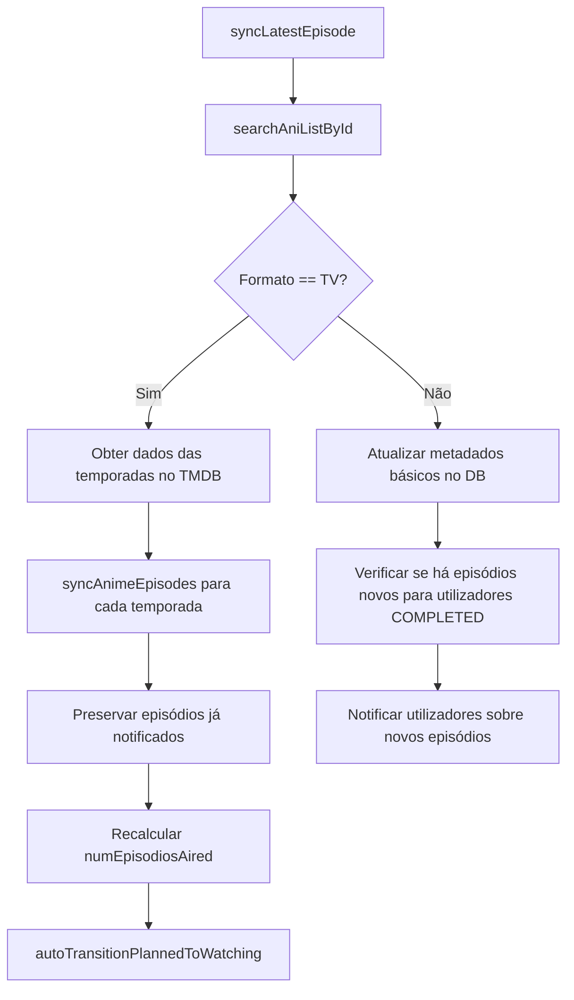
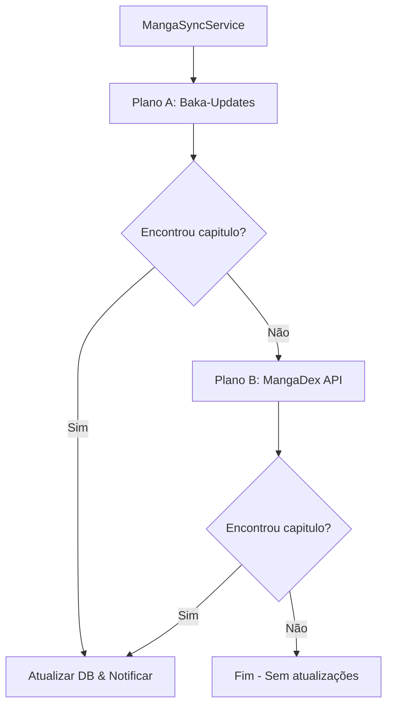

# 🔄 Mecanismos de Sincronização: Otaku Time

Esta página descreve em detalhe o funcionamento técnico e a lógica dos mecanismos de sincronização automática e manual implementados no ecossistema do **Otaku Time**.

---

## 📅 1. Coordenação e Agendamento (Cron Jobs)

A coordenação principal de todas as tarefas de sincronização em segundo plano é realizada no [SyncService](file:///c:/Users/Utilizador/source/repos/Otaku-Time-v2/src/sync/sync.service.ts), utilizando dois agendamentos `@Cron` baseados no pacote `@nestjs/schedule`:

1. **Sincronização Periódica de Dados (`@Cron('0 */30 * * * *')`):** 
   Executada de 30 em 30 minutos. Invoca o método `checkAndRunScheduledSyncs()`, que avalia quais as séries (Anime/Manga) que necessitam de sincronização, põe-nas na fila (tabela `SyncJob`) e arranca o worker (ver secção 8).
2. **Notificações Locais (`@Cron('0 15 * * * *')`):** 
   Executada a cada hora, ao minuto 15 (para não arrancar no mesmo instante que a verificação anterior). Invoca o método `handleLocalNotificationsCron()`, que verifica episódios estreados recentemente e dispara notificações em lote na aplicação.

### 🛡️ Políticas de Otimização e Segurança de Recursos
* **Deteção de Inatividade:** Ambas as tarefas consultam o `KeepAwakeService` ([keep-awake.service.ts](file:///c:/Users/Utilizador/source/repos/Otaku-Time-v2/src/keep-awake.service.ts)). Se não for registada atividade de utilizadores nas últimas **2 horas**, a sincronização automática é saltada para poupar recursos de processamento e acessos à base de dados.
* **Janela Noturna de Poupança:** A sincronização agendada é suspensa se a hora local estiver entre as **2:00 AM e as 7:00 AM** (Europe/Lisbon).
* **Gestão de Sincronizações Presas:** No início de cada verificação, o sistema deteta e marca como `FAILED` todos os registos de sincronização (`SyncLog`) no estado `RUNNING` que estejam em execução há mais de 2 horas.
* **Fila Completa e Salvaguarda de 20h:** Cada obra guarda quando deve voltar a ser sincronizada (`nextSyncAt`): 7 dias depois de uma sincronização bem sucedida, ou mais cedo depois de uma falha (ver secção 7). Antes de iniciar um `ANIME_FULL` ou `MANGA_FULL`, verifica-se se há obras com essa data ultrapassada. Para evitar sobrecargas e timeouts, cada execução trata um lote de até **100 obras, as mais atrasadas primeiro**. Uma sincronização concluída (`SUCCESS`/`PARTIAL`) não se repete antes de 20 horas, por isso um backlog de 400 obras fica resolvido em cerca de 4 dias. Uma sincronização que falhou por inteiro (`FAILED`) pode ser repetida ao fim de 1 hora.
* **Diária e Completa são independentes:** A sincronização das obras em lançamento (`ANIME_ACTIVE`, janelas de manga) e a fila completa são decididas em separado; correr uma não impede a outra no mesmo dia.

---

## 🗂️ 2. Tipos de Janelas de Sincronização

Durante o ciclo de verificação, o sistema divide as tarefas necessárias em quatro janelas distintas:

### A. Sincronização de Anime
* **`ANIME_ACTIVE` (Diária):** Sincroniza apenas as séries em estado ativo/em lançamento (`statusLancamento !== 'FINISHED'` ou similar).
* **`ANIME_FULL` (Semanal / Fila Throttled):** Atualiza os **100 animes mais atrasados** (com o `nextSyncAt` ultrapassado há mais tempo) para atualizar metadados de temporadas e episódios. Caso existam mais de 100 pendentes, novos lotes são processados a cada 20 horas.

### B. Sincronização de Manga
* **`MANGA_MIDDAY` / `MANGA_NIGHT` (Duas vezes por dia):** Sincroniza os mangas em lançamento (`RELEASING`) com base na janela horária atual (Midday a partir das 12:00h e Night a partir das 22:00h).
* **`MANGA_FULL` (Semanal / Fila Throttled):** Atualiza os **100 mangas mais atrasados** (pelo `nextSyncAt`), processando novos lotes a cada 20 horas se o backlog for superior a 100 itens.

---

## 📺 3. Mecanismo de Sincronização de Anime

A lógica de atualização individual de episódios está localizada no [AnimeService](file:///c:/Users/Utilizador/source/repos/Otaku-Time-v2/src/anime/anime.service.ts):

### Detalhes do Fluxo
1. **Importação e Atualização de Informação Básica:** O método `syncLatestEpisode(tmdbId)` consulta as APIs do AniList e TMDB para obter capas, status de lançamento e dados do próximo episódio.
2. **Mapeamento de Episódios (`syncAnimeEpisodes`):** Procura recursivamente no TMDB a lista de episódios de todas as temporadas disponíveis. O sistema monta a lista mantendo a flag `notified: true` para os episódios que o utilizador já sabe que estrearam.
3. **Transições Automáticas de Estado de Acompanhamento:**
   * **De *Concluído* para *A ver*:** Se forem detetados novos episódios no catálogo e o utilizador tinha marcado a obra como `COMPLETED`, o sistema reverte a relação para `WATCHING` e gera uma notificação.
   * **De *Planeado* para *A ver* (`autoTransitionPlannedToWatching`):** Implementado no [CalendarService](file:///c:/Users/Utilizador/source/repos/Otaku-Time-v2/src/anime/calendar.service.ts). Se o primeiro episódio de um anime na lista de desejos (`PLANNED`) estrear, o status do utilizador é movido automaticamente para `WATCHING` ("A ver"), acompanhado de uma notificação interna.

---

## 📖 4. Mecanismo de Sincronização de Manga

Devido à falta de uma API centralizada que forneça o progresso de capítulos de mangas de forma gratuita, o [MangaSyncService](file:///c:/Users/Utilizador/source/repos/Otaku-Time-v2/src/manga/manga-sync.service.ts) implementa um mecanismo resiliente de **duas fontes de dados**:

### Detalhes das Fontes
* **Plano A: Baka-Updates (MangaUpdates)**
  Efetua uma pesquisa por título na API do Baka-Updates. Analisa sintaticamente o texto bruto presente no campo `status` (ex: *"15 Chapters (Complete)"* ou divisões por volumes) para extrair e somar os blocos de capítulos.
* **Plano B: MangaDex (Contingência)**
  Caso o Plano A falhe ou não devolva capítulos válidos, o sistema consulta a API do MangaDex. Associa a obra mapeando o ID do AniList ou recorrendo a correspondências fonéticas de título. De seguida, extrai a contagem mais alta do campo `lastChapter` nos metadados ou lê as últimas entradas do feed de lançamentos da obra (`/feed`).
* **Regras de Negócio e Atualização:**
  Se for encontrado um capítulo superior ao registado localmente:
  * O sistema atualiza o total de capítulos do Manga e define o número esperado para o próximo lançamento.
  * Transita utilizadores com estado `COMPLETED` de volta para `WATCHING` se o progresso lido estiver abaixo do novo máximo.
  * Dispara notificações em tempo real para os leitores ativos: *"O capítulo X de Y foi lançado!"*.

---

## 📋 5. Acompanhamento pelos Administradores

Cada fase de sincronização fica registada na tabela `SyncLog` (estado `RUNNING` → `SUCCESS`/`PARTIAL`/`FAILED`, com detalhes ou erro). Cada fase tem o seu próprio registo: um erro numa fase não impede as seguintes nem altera o resultado das que já terminaram. Uma obra cuja fonte falhou conta como falha (aparece em `PARTIAL`/`FAILED`), nunca como sincronizada. Os administradores consultam esse histórico no painel de admin; não é enviado email nem notificação.

---

## ⚙️ 6. Execução Manual

Os administradores têm à disposição um endpoint de controlo no [SyncController](file:///c:/Users/Utilizador/source/repos/Otaku-Time-v2/src/sync/sync.controller.ts):
* **`POST /sync/start`:** Inicia imediatamente o método `runManualSync()` em background. Esta ação ignora os agendamentos automáticos e executa a sincronização ativa imediata de animes e mangas, registando o processo sob a etiqueta `[MANGA_MANUAL]`. A resposta traz `started: false` se já houver uma sincronização a correr.

No [AnimeController](../src/anime/anime.controller.ts), também só para administradores:
* **`GET /anime/admin/unavailable`:** lista as obras marcadas como `GONE` (a fonte respondeu 404), com o número de utilizadores que as têm na biblioteca.
* **`POST /anime/admin/migrate-id`:** passa uma obra para outro ID do TMDB. Corpo: `{ "fonte": "TMDB_TV", "id": 123, "tmdbId": 456, "format": "TV" }` (origem no catálogo e destino no TMDB). As bibliotecas, listas, avaliações, comentários e notificações dos utilizadores vão atrás numa transação; se algum utilizador já tiver a obra de destino, nada é alterado (409).

---

## 🛡️ 7. Estado de Sincronização e Tolerância a Falhas

* **Estado por obra:** `Anime` e `Manga` guardam `lastSyncedAt` (última sincronização bem sucedida), `nextSyncAt` (quando voltam à fila completa), `syncFailures` (falhas seguidas) e `syncStatus` (`OK` ou `GONE`). O `updatedAt` deixou de servir para isto, porque muda com qualquer escrita.
* **Falha temporária** (rede, timeout, 429, 5xx, resposta incompleta): a obra é adiada com backoff (6h, 12h, 24h, 48h, 96h e depois 7 dias), para não ficar presa no topo da fila.
* **Obra inexistente** (a fonte responde 404): fica `GONE` e sai das filas automáticas. O ID nunca é tentado no outro tipo (série/filme) durante a sincronização, e em lado nenhum é trocado por uma pesquisa de título: passar uma obra para outro ID é uma ação de administração (secção 6). Um refresh manual bem sucedido repõe o estado `OK`.
* **Pedidos HTTP** ([http-client.ts](../src/common/http-client.ts)): timeout de 10s por tentativa e repetição com backoff apenas em falhas de rede, 429 e 5xx, respeitando o `Retry-After`. Usado no TMDB, no Baka-Updates, no MangaDex e em todos os pedidos à AniList ([anilist-client.ts](../src/common/anilist-client.ts)), incluindo pesquisas e recomendações.
* **Lista de episódios completa ou nada:** se uma temporada falhar, a lista guardada não é alterada (uma lista parcial mudava a numeração global dos episódios e as marcas de "já notificado").
* **Uma escrita de cada vez por obra:** dentro do processo, a sincronização, o refresh manual e o cron de notificações partilham um lock por obra ([keyed-mutex.ts](../src/common/keyed-mutex.ts)). As escritas de episódios correm ainda numa transação com um lock da própria base de dados (`pg_advisory_xact_lock`), que protege também entre instâncias do servidor.
* **Transições de estado atómicas:** `COMPLETED → WATCHING` e `PLANNED → WATCHING` são feitas com a condição dentro do próprio `UPDATE`, por isso não passam por cima de uma alteração feita pelo utilizador entretanto. Num anime só contam os episódios já estreados.
* **Manga:** o total de capítulos só sobe (exceto quando a AniList dá a contagem final de uma obra terminada), e os IDs da obra no Baka-Updates e no MangaDex ficam guardados (`mangaUpdatesId`, `mangaDexId`) para não repetir a pesquisa por título.

---

## 🧱 8. Fila de Sincronização, Episódios por Linha e Circuit Breaker

### Fila em Postgres (`SyncJob`)
* **Agendar é só pôr na fila:** cada execução cria um registo no `SyncLog` (`RUNNING`) e um `SyncJob` por obra. Um índice único parcial garante no máximo um job por tratar por obra, por isso pedir a mesma obra duas vezes não duplica trabalho.
* **Worker** ([sync.service.ts](../src/sync/sync.service.ts)): reserva jobs com `FOR UPDATE SKIP LOCKED` (duas instâncias nunca ficam com o mesmo job). Anime e manga correm lado a lado: 3 animes em paralelo (TMDB) e 1 manga de cada vez (AniList, Baka-Updates, MangaDex).
* **Novas tentativas:** uma falha temporária devolve o job à fila (2 min, depois 10 min); à terceira falha fica `FAILED`. Uma obra inexistente (404) falha logo.
* **Fecho da execução:** quando já não há jobs por tratar, o resultado (`SUCCESS`/`PARTIAL`/`FAILED`) é escrito no `SyncLog` a partir dos jobs, e estes são apagados.
* **Reinícios:** a fila fica na base de dados. Jobs reservados há mais de 15 minutos voltam à fila; uma execução com mais de 2 horas é dada como falhada e os jobs que restam são largados (as obras voltam a ser escolhidas na execução seguinte).

### Episódios por linha (`Episode`)
* **Fonte de verdade:** a tabela `Episode` tem uma linha por episódio, com `notifiedAt` (quando a estreia foi tratada). `Anime.episodesList` continua a existir como cópia de leitura para a app, mas só é regravada quando algum episódio muda.
* **Aplicação atómica** ([episode-store.service.ts](../src/anime/episode-store.service.ts)): numa única transação criam-se os episódios novos, atualizam-se os alterados, apagam-se os removidos, fazem-se as transições de estado e criam-se as notificações. Um episódio nunca fica marcado sem a notificação ter sido criada, nem é notificado duas vezes.
* **Cron de notificações:** uma consulta à tabela diz que obras têm episódios estreados por tratar; já não carrega a lista de todas as obras em lançamento.
* **Obras existentes:** no arranque, as obras que só têm a lista antiga em JSON ganham as suas linhas (`backfillFromJson`, idempotente). Episódios estreados há mais de 7 dias ficam como já tratados.

### Circuit breaker por fornecedor
* [circuit-breaker.ts](../src/common/circuit-breaker.ts): depois de 5 pedidos seguidos falhados (já com as repetições) a um fornecedor (`tmdb`, `anilist`, `mangaupdates`, `mangadex`), os pedidos a esse fornecedor falham logo durante 5 minutos, sem ir à rede. Passada a pausa, um pedido de teste decide se fecha ou volta a abrir.
* Com o fornecedor em pausa, os jobs esperam por ele: não gastam tentativas e a obra não fica com uma falha registada.
